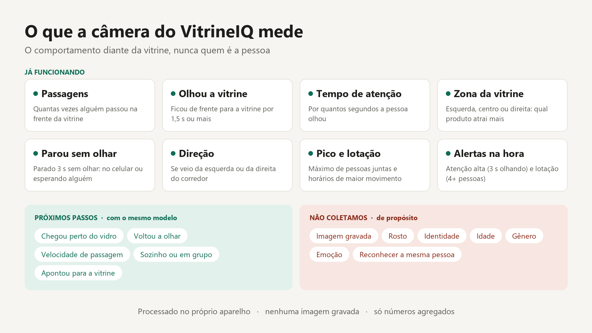

# computer-vision

Visão computacional da vitrine do VitrineIQ. Uma webcam virada para o corredor conta quem **passa**, quem **olha** a vitrine, por quanto tempo e para qual parte (esquerda, centro ou direita). Também dispara alertas na hora: **atenção alta** (3 s olhando) e **lotação** (4 ou mais pessoas).



## Privacidade

- Tudo é processado no próprio aparelho. Nenhuma imagem é gravada ou enviada.
- Na janela de preview (a que aparece na demo e no vídeo), a cabeça de cada pessoa detectada é **pixelizada antes de desenhar**, sempre, sem opção de desligar. A região vem dos pontos de nariz, olhos e orelhas da pose; de costas, cobre o terço de cima da pessoa. O desfoque usa um limiar de confiança mais baixo que a contagem, para pegar também quem está ao fundo.
- Só saem **contagens agregadas**: um resumo a cada 10 s em `vitrine_eventos.json` e os alertas em `vitrine_alertas.json`.
- Não há rosto, identidade, idade, gênero nem reconhecimento da mesma pessoa.

## Como funciona

YOLO11 pose (`yolo11n-pose.pt`, Ultralytics) com rastreamento por ID. A pose (olhos, ombros, pulsos) diz se a pessoa está de frente, apontando ou no celular.

| Módulo | Papel |
|---|---|
| `config.py` | parâmetros (tempo para "olhou", gatilhos, zonas). Calibre na vitrine real |
| `pose.py` | leitura dos 17 pontos da pose |
| `analise.py` | regras do funil e resumo de quem já foi embora |
| `camera.py` | loop da câmera, resumos e alertas |
| `armazenamento.py` | gravação segura dos JSON |
| `relatorio.py` | relatório por faixa de horário no terminal |
| `lojista.py` | relatório HTML de uma página para o lojista ([exemplo](relatorio_lojista.html)) |

## Como rodar

É preciso ter o [uv](https://docs.astral.sh/uv/) e o Python 3.14.

```bash
cd computer-vision
uv sync
uv run vitrine-camera      # liga a webcam; q ou Ctrl+C para parar
uv run vitrine-relatorio   # resumo por hora no terminal (ou: uv run vitrine-relatorio 15)
uv run vitrine-lojista     # gera e abre o relatorio_lojista.html
uv run pytest              # testes
```

### Variáveis

| Variável | Para quê | Exemplo |
|---|---|---|
| `VITRINE_CAMERA` | índice da câmera (0 = webcam do notebook) | `1` para a Logitech C925e USB |
| `VITRINE_API_URL` | envia resumos e alertas para a API; sem ela, só grava os JSON locais | `http://localhost:8000` |
| `VITRINE_ALA` | ala do shopping que a câmera observa (id do painel) | `ala-lazer-cinema` |

Na demo (PowerShell):

```powershell
$env:VITRINE_CAMERA = '1'; $env:VITRINE_API_URL = 'http://localhost:8000'; $env:VITRINE_ALA = 'ala-lazer-cinema'; uv run vitrine-camera
```

Para descobrir o índice de cada câmera, o Windows lista os nomes com `Get-PnpDevice -Class Camera`; o índice da USB costuma ser o seguinte ao da integrada. No Windows o projeto usa o DirectShow, porque o backend padrão (MSMF) trava ao abrir webcams USB.

Na primeira execução, o modelo é baixado do GitHub da Ultralytics. Atrás de um proxy corporativo que troca o certificado SSL, rode com `VITRINE_SSL_VERIFY=0`, que vale só para esse download.

## Integração com a API (T3, issue #29)

Com `VITRINE_API_URL` definida, cada resumo e cada alerta também vão para a API (`envio.py`, numa thread para não travar o vídeo). Se a API cair, o JSON local continua valendo:

- `POST /vitrine/eventos`: cada resumo de 10 s, no mesmo formato do `vitrine_eventos.json`;
- `POST /vitrine/alertas`: `atencao_alta`, `lotacao` e `apontou`;
- `GET /vitrine/resumo`: passantes, % que olhou, pico e ações, com a mesma lógica de `resumo()` e `acoes()` de `lojista.py`.

Os valores são estimativas. A precisão ainda não foi validada com contagem manual.
