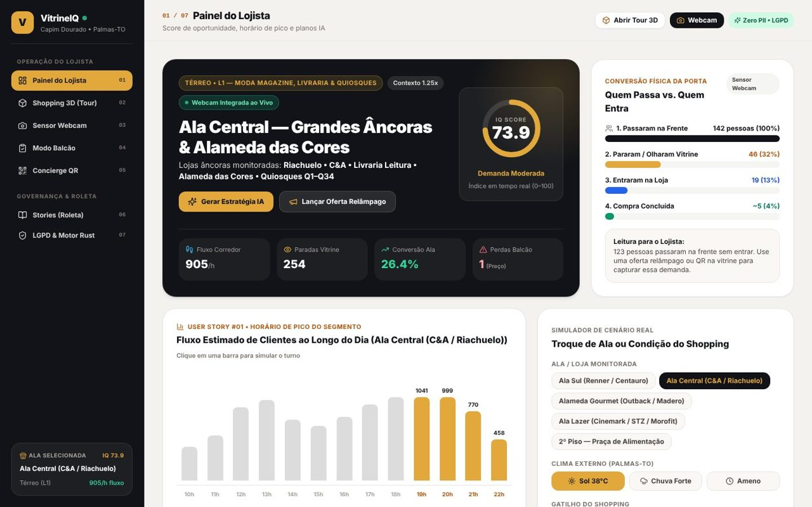
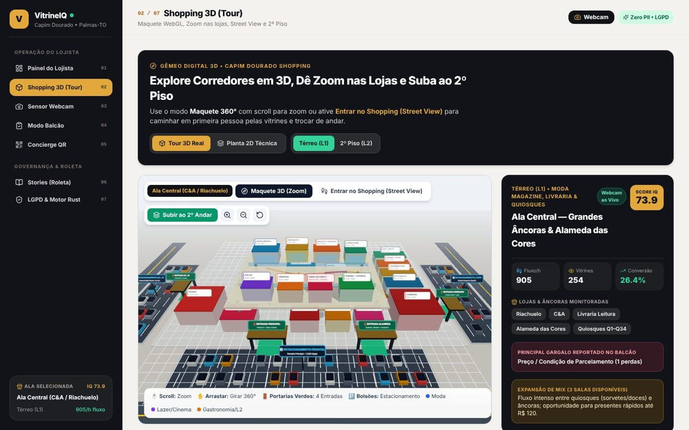
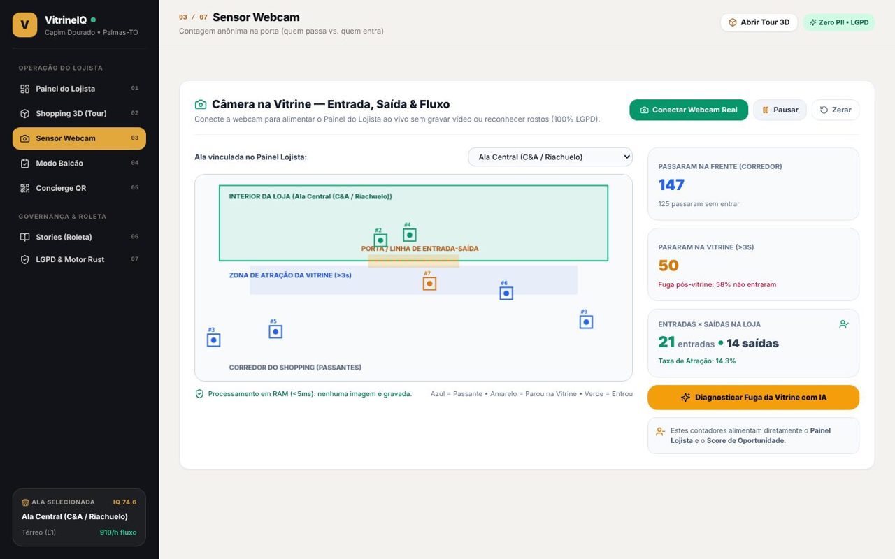
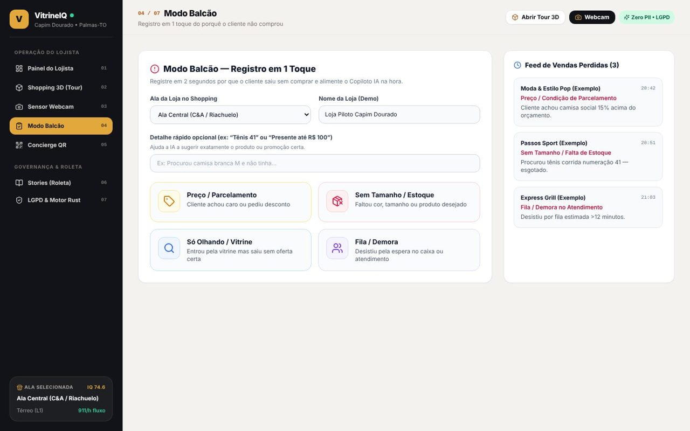
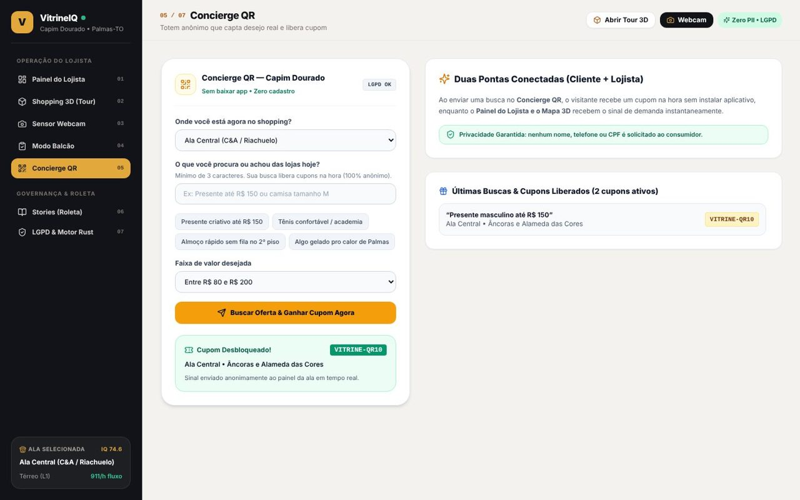
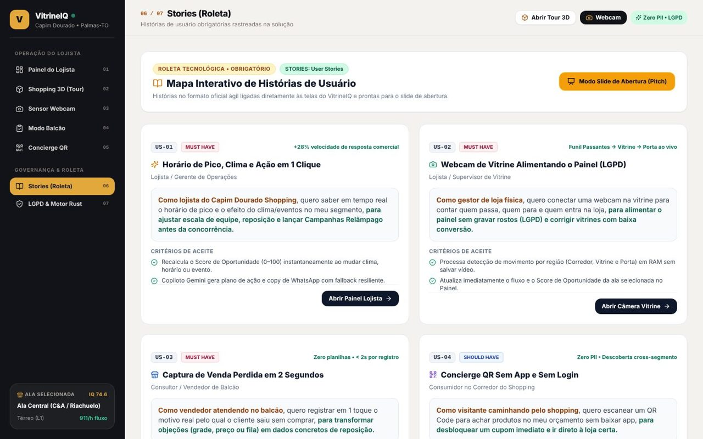
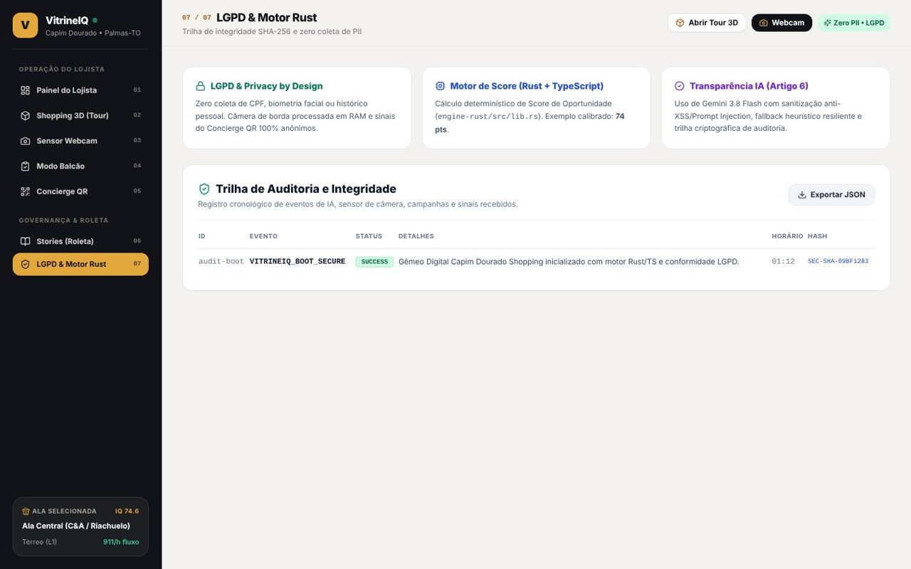
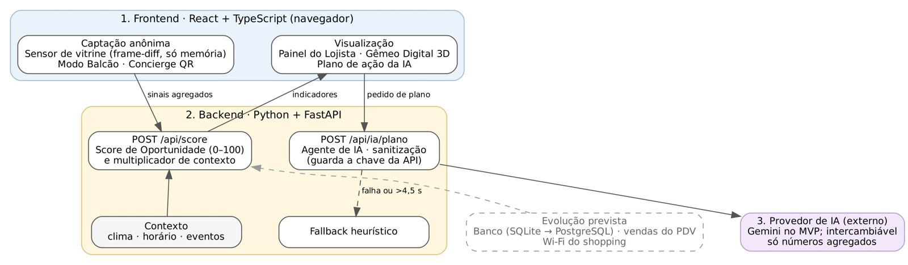

# Missão 1 · Primeira entrega: planejamento técnico

**VitrineIQ** · Time Nido King · Desafio 06 – Inteligência comercial para lojistas · Capim Dourado Shopping

> 📄 **Versão em PDF para download:** [`01_Planejamento_Tecnico_v1.1.pdf`](./01_Planejamento_Tecnico_v1.1.pdf) · Anexo: [`02_Documento_de_Requisitos_v1.1.pdf`](./02_Documento_de_Requisitos_v1.1.pdf)
> 🌐 **Protótipo publicado:** https://vitrineiq-capim-dourado.vercel.app

| # | Item exigido | Ir para |
|---|---|---|
| 1 | Proposta e estrutura inicial das telas | [Seção 1](#1-proposta-e-estrutura-inicial-das-telas) |
| 2 | Documentação inicial do projeto | [Seção 2](#2-documentação-inicial-do-projeto) |
| 3 | Linguagem de programação escolhida | [Seção 3](#3-linguagem-de-programação-escolhida) |
| 4 | Arquitetura proposta | [Seção 4](#4-arquitetura-proposta) |
| 5 | Plataforma e tecnologias adotadas | [Seção 5](#5-plataforma-e-tecnologias-adotadas) |
| 6 | Prática sorteada: User Stories | [Seção 6](#6-prática-sorteada-user-stories) |

---

## 1. Proposta e estrutura inicial das telas

Aplicação web única, com navegação lateral entre sete telas. Funciona no notebook da gerência, no tablet do balcão e no celular do visitante.

| Tela | O que mostra | História |
|---|---|---|
| Painel do Lojista | Score de Oportunidade (0–100), funil da porta (passaram → pararam → entraram → compraram), horário de pico 10h–22h, simulação de clima e eventos, plano do Agente de IA | US01 |
| Shopping 3D | Maquete navegável dos dois pavimentos com calor de demanda por ala, troca de pavimento, modo caminhada e planta 2D | US05 |
| Sensor de Vitrine | Webcam (ou simulador) que conta quem passa, para, entra e sai, sem gravar imagens | US02 |
| Modo Balcão | Vendedor registra em um toque o motivo da venda perdida | US03 |
| Concierge QR | Visitante informa o que procura, sem login nem CPF, e recebe a campanha ativa | US04 |
| User Stories | Mapa das histórias com atalho para a tela que implementa cada uma | Prática sorteada |
| LGPD e Auditoria | Regras de privacidade e trilha de auditoria dos registros | RNF02, RNF03 |

<table>
<tr><td> Painel do Lojista</td><td> Shopping 3D</td></tr>
<tr><td> Sensor de Vitrine</td><td> Modo Balcão</td></tr>
<tr><td> Concierge QR</td><td> User Stories</td></tr>
<tr><td> LGPD e Auditoria</td><td></td></tr>
</table>

## 2. Documentação inicial do projeto

**Problema.** Os lojistas do Capim Dourado só enxergam as vendas da própria loja. Não sabem quem circula, por que o cliente entra e sai sem comprar, nem como horário, clima e eventos afetam o desempenho.
**Público-alvo.** Lojistas e gerentes de lojas satélite, seus vendedores e a administração do shopping.
**Proposta de valor.** Transformar sinais anônimos do corredor, da vitrine e do balcão em decisões de vitrine, estoque, equipe e ofertas, dentro da LGPD.

| Artefato | Onde está |
|---|---|
| Documento de Requisitos (RF, RNF, casos de uso, regras, glossário, User Stories) | [`02_Documento_de_Requisitos_v1.1.pdf`](./02_Documento_de_Requisitos_v1.1.pdf) |
| Defesa do problema | [`materiais-de-apoio/planejamento/TEMPLATE_DEFESA_DO_PROBLEMA.md`](../materiais-de-apoio/planejamento/TEMPLATE_DEFESA_DO_PROBLEMA.md) |
| Lean Canvas | [`materiais-de-apoio/planejamento/TEMPLATE_LEAN_CANVAS.md`](../materiais-de-apoio/planejamento/TEMPLATE_LEAN_CANVAS.md) · [versão visual](../materiais-de-apoio/planejamento/canvas_executivo.html) |
| Backlog MoSCoW | [`materiais-de-apoio/planejamento/TEMPLATE_BACKLOG_REQUISITOS.md`](../materiais-de-apoio/planejamento/TEMPLATE_BACKLOG_REQUISITOS.md) |
| Acordo do time, OKRs e daily | [`materiais-de-apoio/planejamento/ACORDO_DE_TRABALHO_E_KANBAN.md`](../materiais-de-apoio/planejamento/ACORDO_DE_TRABALHO_E_KANBAN.md) |
| Kanban | https://github.com/users/arthurfogolinrocha/projects/1 |

## 3. Linguagem de programação escolhida

- **TypeScript (strict) com React 19 – frontend:** interface, mapa 3D e sensor de vitrine, com tipagem para telemetria, zonas (L1/L2), eventos de balcão e respostas da IA.
- **Python – backend:** API em FastAPI que calcula o Score de Oportunidade, sanitiza as entradas e chama o Agente de IA guardando a chave no servidor. Forte em dados e integração com IA, e facilita evoluções como importar vendas em planilha (pandas).

## 4. Arquitetura proposta

1. **Frontend (React + TypeScript, navegador):** sensor óptico (WebRTC + frame-diff em Canvas) processa a imagem só em memória; Modo Balcão e Concierge QR captam sinais ativos; Painel e Gêmeo Digital 3D exibem os indicadores.
2. **Backend (Python + FastAPI):** `POST /api/score` calcula o score (0–100) e o multiplicador de contexto; `POST /api/ia/plano` chama o Agente de IA com timeout de 4,5 s, bloqueio de prompt injection e fallback heurístico. Documentação em `/docs`, testes com pytest.
3. **Provedor de IA (externo):** recebe só números agregados. Gemini no MVP, provedor intercambiável.

> Evolução prevista: banco de dados (SQLite → PostgreSQL), vendas do PDV e percurso agregado pelo Wi-Fi do shopping.

## 5. Plataforma e tecnologias adotadas

| Camada | Tecnologia | Papel |
|---|---|---|
| Interface | React 19, TypeScript, Vite 6 | Web responsiva para tablet, notebook e celular |
| Estilo | Tailwind CSS 3, Lucide Icons | Identidade visual |
| Mapa | Three.js (WebGL, OrbitControls) | Maquete 3D dos dois pavimentos |
| Sensor de vitrine | MediaDevices API, HTML5 Canvas | Detecção de movimento no navegador, sem gravação |
| API | Python, FastAPI, Uvicorn | Score, sanitização e Agente de IA |
| IA | Agente de IA via API (Gemini no MVP) + fallback | Plano de ação, texto de cupom, parcerias |
| Hospedagem | Vercel | Frontend com HTTPS e deploy a cada commit |
| Qualidade | Vitest, pytest | Testes do frontend e do backend |
| Gestão | GitHub, GitHub Projects | Versionamento e Kanban |

## 6. Prática sorteada: User Stories

Todos os requisitos são escritos como histórias ("Como <persona>, quero <ação>, para <benefício>") com critérios Dado / Quando / Então, usadas do planejamento à apresentação:

1. **Planejamento:** backlog priorizado em MoSCoW define o escopo do MVP.
2. **Organização:** cada história vira um cartão no Kanban, com responsável e critério de pronto.
3. **Desenvolvimento:** commits citam a história, ex.: `feat(US03): registro de venda perdida`.
4. **Validação:** os critérios de aceitação são o checklist de testes.
5. **No produto:** a tela User Stories abre a funcionalidade de cada história.

| ID | História | Prioridade |
|---|---|---|
| US01 | Como lojista, quero saber o horário de pico e o efeito do clima e dos eventos no meu segmento e gerar campanhas relâmpago, para ajustar equipe, estoque e promoções. | Must |
| US02 | Como gerente de loja, quero uma webcam na vitrine que conte quem passa, para e entra, para alimentar o painel sem gravar imagens. | Must |
| US03 | Como vendedor, quero registrar em segundos por que o cliente não comprou, para que faltas e objeções virem ação. | Must |
| US04 | Como consumidor, quero dizer o que procuro pelo QR e receber um cupom sem cadastro, para encontrar o produto certo rapidamente. | Should |
| US05 | Como gestor do shopping, quero ver os pavimentos em 3D com calor de demanda e espaços vagos, para identificar rotas e oportunidades. | Should |

Critérios de aceitação completos: seção 8 do [Documento de Requisitos](./02_Documento_de_Requisitos_v1.1.pdf).

---

**Uso de IA:** o time usou assistentes de IA na ideação, pesquisa, documentação, código e testes; todo o conteúdo foi revisado pelo time (seção 8 do PDF).
